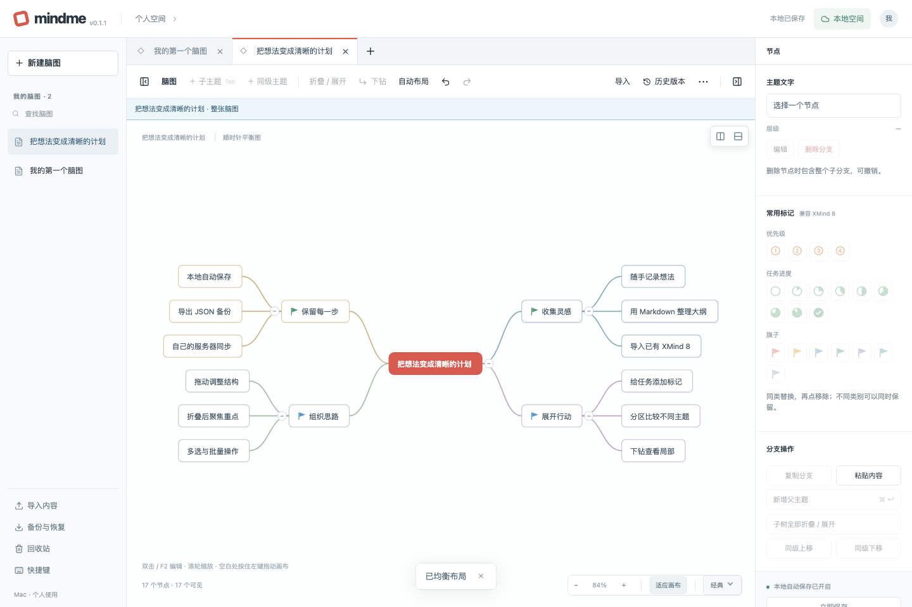

# mindme

支持离线编辑与实时同步的自托管脑图应用，当前版本为 **0.1.5**。前端可独立在本地使用；需要跨设备同步时，可部署 Node.js、SQLite 和 WebSocket 后端，并使用 Passkey 登录。



截图由本地演示数据生成，不含个人脑图。此仓库提供源码和自托管方法，不提供公共在线账号。

## 功能

- 节点原位编辑、中文输入、自动换行、折叠、标记、拖拽和自动布局。
- 多选及批量复制、剪切、删除、挂接，支持本机撤销/重做。
- 多图标签、递归分区画布、子树下钻；视角和选择保存在本浏览器。
- Markdown 大纲与 XMind 8 导入，单图/全空间 JSON 备份，历史版本和回收站。
- IndexedDB 本地保存、待同步队列、断网编辑及联网重试；构建后的应用壳支持已访问设备离线加载。
- 可选 Node.js/SQLite 后端提供跨设备增量同步、WebSocket 通知、Passkey、离线恢复码和会话续期。

## 技术栈

React 19、TypeScript、Vite、自有 SVG 布局、IndexedDB；服务端使用 Node.js、SQLite WAL、WebSocket 和 SimpleWebAuthn。布局与导入在浏览器主线程运行。

`server/` 是推荐且维护的自托管后端。`workers/` 中的 Cloudflare Worker/Durable Object 入口作为历史兼容实现公开，不承诺完整部署支持；其中认证与 HTTP 公共模块也被 Node 后端复用，不能直接删除。

## 本地启动

推荐 Node.js 24；前端工程最低要求 Node.js 22.16。首次安装需要访问 npm。

```bash
npm ci
npm run dev
```

打开 `http://localhost:5173`。该模式无需云平台凭据，内容保存在当前浏览器的 IndexedDB；跨浏览器迁移请导出 JSON。开发服务器不提供离线应用壳。

## 测试与构建

```bash
npm run check
npm run test:prototype
npm run build
npm run build:server
npx playwright install chromium webkit
npm run test:e2e:ci
npm run test:node
```

`test:e2e:ci` 只运行 Chromium、WebKit，不要求安装 Google Chrome。`npm run test:e2e` 还会运行本机 Chrome 项目。详情和已知跳过项见[测试说明](docs/测试说明.md)。

静态构建在 `dist/`，后端构建在 `dist-server/`。仅预览前端构建时使用 `npm run preview`；完整后端运行方法见[本地开发](docs/本地开发.md)。

## 本地后端配置

复制 `.env.example` 为 `.env`，生成至少 32 字符的随机会话密钥并替换 `SESSION_SECRET`。该文件仅用于自己的本机环境，不要提交。

```bash
node -e "console.log(require('node:crypto').randomBytes(48).toString('base64url'))"
npm run build
npm run build:server
node --env-file=.env dist-server/cli.js passkey-setup --fresh
node --env-file=.env dist-server/index.js
```

`--fresh` 仅用于真正空白的新数据库，已有数据时会拒绝。打开 `http://localhost:3180`，输入命令生成的 15 分钟设置令牌，完成 Passkey 登记并妥善保存恢复码。令牌和恢复码都不应出现在 Issue、截图或日志附件中。

## 数据存储

纯本地模式将内容、待同步操作和编辑草稿保存在 IndexedDB；当前图、视角、选择及分区布局属于本浏览器偏好。同步模式另外将空间与认证记录保存于服务端 SQLite 数据卷。

界面导出的 JSON 用于迁移脑图内容，**不包含**全部历史、回收站、待同步队列或认证信息，不能替代服务端完整备份。Passkey 部署应使用 SQLite 一致性备份，并独立保存环境密钥；详见[数据协议](docs/数据协议.md)和[自托管部署](docs/自托管部署.md)。

## 自托管

推荐使用 `deploy/compose.yaml`，配合自己的 HTTPS 域名及反向代理。示例域名 `https://mindme.example` 只是占位符，需要替换为自己的站点来源。

[自托管部署指南](docs/自托管部署.md)包含环境变量、初始化、HTTPS、备份恢复、升级与回滚方法。

## 编辑器快捷操作

- 画布内保留缩放、适应画布和风格切换；操作说明可从左侧「快捷键」查看。
- 在右侧设置图标后，顶部操作栏显示本机使用次数最多的图标，最多 5 个；次数相同时按最近使用排序。单次成功设置计一次，多选不按节点数累计，移除不累计；次数仅保存在当前浏览器，不同步到其他设备。
- 顶部常用图标支持当前多选的批量设置和移除、一步撤销/重做；右侧面板收起后仍可使用。
- `Command+[` 切换左侧脑图列表，`Command+]` 切换右侧节点面板；Windows/Linux 可用 `Ctrl`。文字输入、输入法组合和弹窗期间不触发侧栏快捷键。

## 当前限制

- 单用户空间，不提供公开注册、多租户、角色权限或多人协作光标。
- 导入面向 XMind 8 ZIP/XML；不承诺兼容所有新版或专有 XMind 格式，也不保证像素布局一致。
- 每图最多 5000 个节点，空间最多 200 张图；接近上限时需结合设备性能评估。
- 本地撤销、视角、选择和分区布局不跨设备同步；Passkey 依赖浏览器与设备支持。
- 首次加载需要联网；清除浏览器站点数据可能丢失尚未备份或同步的本地内容。
- 自动化测试不能代替真实设备输入法、Passkey、公网双设备和备份恢复人工验收。
- 大空间历史可能提高内存与备份开销，`inspect` 命令会读取完整空间，不适合作为周期性健康检查。

## 文档与贡献

- [本地开发](docs/本地开发.md)、[架构说明](docs/架构说明.md)、[数据协议](docs/数据协议.md)、[测试说明](docs/测试说明.md)
- [变更日志](CHANGELOG.md)、[贡献指南](CONTRIBUTING.md)、[第三方依赖](docs/第三方依赖.md)
- Bug 和功能建议请使用 Issues；暂不开启 Discussions。
- 安全问题请按 [SECURITY.md](SECURITY.md) 私下报告，不要公开尚未修复的漏洞细节。

## 许可证

项目采用 [MIT License](LICENSE)，版权署名为 `yihannangua`。第三方组件仍遵守各自许可证；原始许可文本随源码和依赖通知保留。
